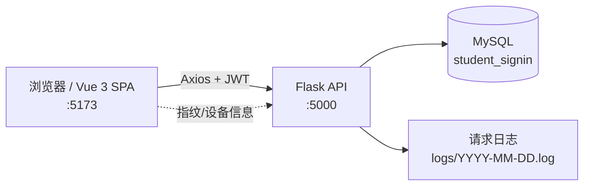
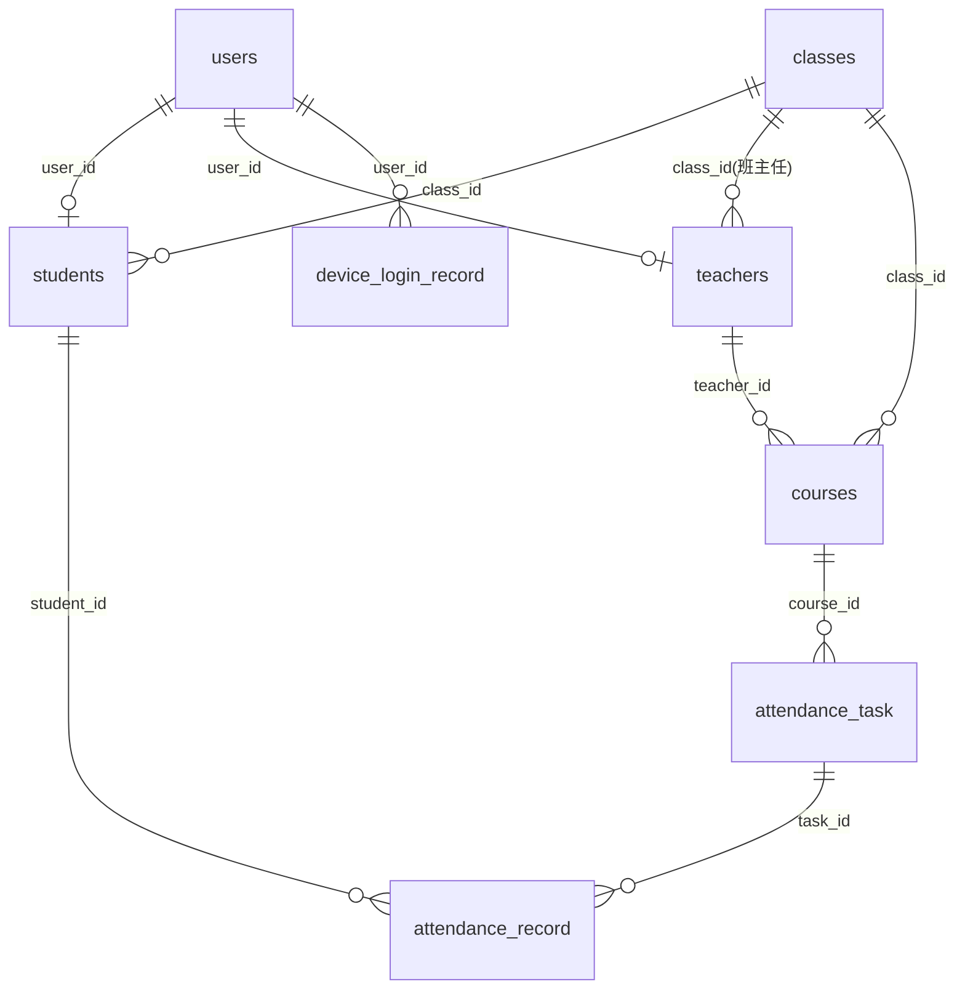

# 学生签到系统（Student Sign-in System）

一个面向高校课堂的 **学生签到 / 考勤管理** 系统，采用前后端分离架构：

- **后端**：Python + Flask + MySQL，提供 RESTful API，JWT 鉴权；另提供接口一致的 Java 25 + Spring Boot 版（见第 14 节）；
- **前端**：Vue 3 + Vite + TypeScript，按角色（学生 / 教师 / 管理员）提供独立工作台。

系统覆盖「教师发起签到 → 学生限时签到 → 教师核对名册与补录 → 统计分析」的完整考勤闭环，并内置**设备限制**与**反作弊（脚本 / 爬虫）检测**机制。

---

## 目录

- [1. 功能特性](#1-功能特性)
- [2. 技术栈](#2-技术栈)
- [3. 项目结构](#3-项目结构)
- [4. 系统架构与业务流程](#4-系统架构与业务流程)
- [5. 数据库设计](#5-数据库设计)
- [6. API 接口文档](#6-api-接口文档)
- [7. 安全与反作弊机制](#7-安全与反作弊机制)
- [8. 环境要求与安装部署](#8-环境要求与安装部署)
- [9. 运行说明](#9-运行说明)
- [10. 示例账号](#10-示例账号)
- [11. 日志说明](#11-日志说明)
- [12. 调试与测试脚本](#12-调试与测试脚本)
- [13. 注意事项](#13-注意事项)
- [14. Java 版后端（BE_Java）](#14-java-版后端be_java)

---

## 1. 功能特性

### 1.1 学生端

| 功能 | 说明 |
| --- | --- |
| 登录 | 支持使用 **用户名 / 学号 / 姓名** 登录，携带设备标识 `device_id` |
| 今日课程 | 展示本班今日课程，实时显示「未开始 / 签到进行中 / 已签到 / 已结束」状态 |
| 一键签到 | 在签到时间窗口内签到，可附加地理位置；签到结果区分 **正常 / 迟到** |
| 签到记录 | 查看个人历史签到记录，支持按日期筛选，脚本签到以红色标注 |
| 班级签到情况 | 查看本班全部同学在某天的各课程签到汇总（正常 / 迟到 / 旷课 / 请假等） |

### 1.2 教师端

| 功能 | 说明 |
| --- | --- |
| 我的课程 | 查看自己任教的所有课程（含班级、日期、时间段） |
| 签到任务 | 创建 / 关闭 / 删除签到任务，查看任务列表与已签到人数 |
| 签到名册 | 按任务查看全班名册，未签到自动判定为「未签到 / 旷课」 |
| 课堂点名 | 手动修改学生签到状态，或为缺勤学生补录（病假 / 事假等） |
| 统计分析 | 基于 ECharts 展示签到趋势、状态分布、各任务明细 |

### 1.3 管理员端

| 功能 | 说明 |
| --- | --- |
| 数据概览 | 教师账户、学生账户、行政班级、课程安排数量统计 |
| 账户管理 | 查看 / 新建 / 删除教师账户与学生账户，分配班级 |
| 班级管理 | 新建 / 删除班级，指定班主任 |
| 课程管理 | 新建 / 删除课程，关联授课教师与班级 |
| 用户管理 | 重置用户密码、启用 / 禁用账号 |

### 1.4 通用

- JWT 令牌鉴权（有效期 7 天），按角色控制接口访问；
- 全量 API 请求日志（含 IP、耗时、身份、请求体脱敏）；
- 爬虫 / 自动化脚本检测（HTTP 特征 + 浏览器指纹双重校验）。

---

## 2. 技术栈

### 后端

| 组件 | 版本 / 说明 |
| --- | --- |
| Python | 3.9 / 3.11 / 3.12（`__pycache__` 中存在多版本编译产物） |
| Flask | Web 框架 |
| flask-cors | 跨域支持（`/api/*` 允许所有来源） |
| flask-jwt-extended | JWT 鉴权 |
| PyMySQL | MySQL 驱动（`DictCursor`，自动提交） |
| Werkzeug | 密码哈希（`scrypt`）与校验 |
| MySQL | 8.x，字符集 `utf8mb4` |

### 前端

| 组件 | 版本 |
| --- | --- |
| Vue | ^3.5.41 |
| Vue Router | ^5.3.1 |
| Axios | ^1.20.0 |
| ECharts | ^6.1.0 |
| Vite | ^8.2.2 |
| TypeScript | ~6.0.2 |
| vue-tsc | ^3.3.11 |

---

## 3. 项目结构

```
stu_v2/
├── Readme.md                     # 本文档
└── main/
    ├── BE/                       # 后端（Flask）
    │   ├── main.py               # 应用入口：JWT、CORS、日志中间件、爬虫检测
    │   ├── core/                 # 公共基础模块
    │   │   ├── database.py       # MySQL 连接配置与连接池（get_db()）
    │   │   └── auth_utils.py     # JWT 身份解析 + 角色校验（各蓝图共用）
    │   ├── api/                  # HTTP 接口蓝图
    │   │   ├── auth.py           # 登录接口 /api/auth/login
    │   │   ├── student.py        # 学生接口 /api/student/*
    │   │   ├── teacher.py        # 教师接口 /api/teacher/*
    │   │   ├── admin.py          # 管理员接口 /api/admin/*
    │   │   └── system.py         # 系统公共接口 /api/system/*（无需登录）
    │   ├── sync/                 # 跨站签到数据同步
    │   │   ├── config.py         # 站点标识与对端配置（SITE_CODE / PEERS）
    │   │   ├── contract.py       # 归一化规则、对齐键与事件信封
    │   │   ├── client.py         # 出站 HTTP 客户端（仅标准库 urllib）
    │   │   ├── store.py          # 同步表（sync_cursor / sync_outbox）与读写
    │   │   ├── worker.py         # 后台同步线程：推送 / 拉取 / 对账
    │   │   └── api.py            # 同步接口 /api/sync/*
    │   ├── debug_jwt.py          # JWT 调试脚本
    │   └── logs/                 # 按天写入的请求日志（YYYY-MM-DD.log）
    ├── BE_Java/                  # 后端（Java 25 + Spring Boot，接口与 BE 一致）
    │   ├── pom.xml               # Maven 构建（含 ProGuard 混淆）
    │   ├── proguard.conf         # 混淆规则
    │   ├── src/main/resources/   # application.yml、logback-spring.xml
    │   └── target/               # 构建产物 student-signin-backend.jar
    ├── FE/                       # 前端（Vue 3 + Vite）
    │   ├── index.html            # 入口 HTML（标题：学生签到系统）
    │   ├── vite.config.ts        # 开发服务器 0.0.0.0:5173 + 产物分包
    │   ├── package.json
    │   └── src/
    │       ├── main.ts           # 应用挂载
    │       ├── App.vue           # 根组件（router-view）
    │       ├── router/index.ts   # 路由表（组件懒加载）
    │       ├── api/request.ts    # Axios 实例 + 拦截器（自动附加 JWT）
    │       ├── utils/
    │       │   ├── device.ts         # 设备 ID 生成与持久化
    │       │   └── fingerprint.ts    # 浏览器自动化指纹检测
    │       ├── types/student.ts      # 类型定义
    │       └── views/
    │           ├── Login.vue             # 登录页
    │           ├── StudentDashboard.vue  # 学生工作台
    │           ├── teacherDashboard.vue  # 教师工作台
    │           └── AdminDashboard.vue    # 管理员工作台
    └── sql/
        ├── student_signin0917.sql    # 数据库结构与示例数据
        └── class_stu.sql             # 班级 / 学生数据
```

---

## 4. 系统架构与业务流程

### 4.1 架构图



- 前端通过 `window.location.hostname` 动态拼接后端地址：`http://${host}:5000`，因此无论通过 `localhost` 还是局域网 IP 访问前端，都能正确请求后端。
- Axios 请求拦截器自动从 `localStorage.access_token` 读取 JWT 并附加 `Authorization: Bearer <token>`。

### 4.2 核心业务流程

**① 登录流程**

```
用户输入 账号 + 密码
   └─ 前端 getDeviceId() 生成/读取设备 UUID（localStorage）
   └─ POST /api/auth/login { username, password, device_id }
        ├─ 查询 users（LEFT JOIN students / teachers / classes）
        ├─ 校验密码（Werkzeug check_password_hash）
        ├─ 校验账号状态（status=1）
        ├─ 学生角色：校验「每台设备每天只能登录一个学生账号」
        │    （device_login_record 唯一索引 uk_device_login_date）
        └─ 签发 JWT（identity=user_id，claims 含 role）
   └─ 按角色跳转对应工作台
```

**② 签到流程**

```
教师 POST /api/teacher/attendance/create
   └─ 创建 attendance_task（start_time / end_time，status=1）

学生 POST /api/student/signin { course_id, device_id, location, client_fp }
   ├─ 校验学生、课程归属班级
   ├─ 查找进行中的任务：NOW() BETWEEN start_time AND end_time + 10min
   ├─ 校验是否已签到（同一 task + student 唯一）
   ├─ 校验设备：同一任务下同一设备只能为一个学生签到
   ├─ 判定状态：NOW() <= end_time → 正常(1)，否则 → 迟到(2)
   ├─ 脚本签到检测 → attendance_record.is_script
   └─ 写入 attendance_record
```

**③ 考勤判定规则**

| 场景 | 判定 |
| --- | --- |
| `NOW() <= end_time` | 正常（status=1） |
| `end_time < NOW() <= end_time + 10min` | 迟到（status=2） |
| `NOW() > end_time + 10min` | 不允许签到（名册中记为旷课） |
| 任务时段内无签到记录 | 未签到（status=7） |
| 任务时段结束后无签到记录 | 旷课（status=3） |

> 迟到宽限期为 **10 分钟**，在 `api/student.py` 与 `api/teacher.py` 中均以 `DATE_ADD(end_time, INTERVAL 10 MINUTE)` 实现。

---

## 5. 数据库设计

数据库名：`student_signin`，字符集 `utf8mb4`，主键统一使用 `char(36)` UUID。

### 5.1 ER 关系



### 5.2 数据表说明

#### users —— 用户表

| 字段 | 类型 | 说明 |
| --- | --- | --- |
| `id` | char(36) | 主键，用户 UUID |
| `username` | varchar(50) | 用户名（唯一） |
| `password` | varchar(255) | Werkzeug 密码哈希（scrypt） |
| `role` | tinyint | 角色：**1 学生 / 2 教师 / 3 管理员** |
| `phone` | varchar(20) | 手机号 |
| `status` | tinyint | 状态：**1 正常 / 0 禁用** |
| `create_time` | timestamp | 创建时间 |

#### students —— 学生表

| 字段 | 类型 | 说明 |
| --- | --- | --- |
| `id` | char(36) | 学生 UUID |
| `user_id` | char(36) | 关联 `users.id`（唯一，级联删除） |
| `student_no` | varchar(32) | 学号（唯一） |
| `name` | varchar(50) | 姓名 |
| `class_id` | char(36) | 班级 ID（班级删除时置空） |

#### teachers —— 教师表

| 字段 | 类型 | 说明 |
| --- | --- | --- |
| `id` | char(36) | 教师 UUID |
| `user_id` | char(36) | 关联 `users.id`（唯一，级联删除） |
| `name` | varchar(50) | 姓名 |
| `department` | varchar(50) | 所属院系 |
| `class_id` | char(36) | 所属 / 班主任班级（可空） |

#### classes —— 班级表

| 字段 | 类型 | 说明 |
| --- | --- | --- |
| `id` | char(36) | 班级 UUID |
| `name` | varchar(50) | 班级名称 |
| `grade` | varchar(50) | 年级，如 `2024级` |
| `teacher_id` | char(36) | 班主任教师 ID（删除教师时置空） |

#### courses —— 课程表

| 字段 | 类型 | 说明 |
| --- | --- | --- |
| `id` | char(36) | 课程 UUID |
| `name` | varchar(100) | 课程名称 |
| `teacher_id` | char(36) | 授课教师 ID（级联删除） |
| `class_id` | char(36) | 班级 ID（级联删除） |
| `course_date` | date | 上课日期，如 `2026-09-17` |
| `time` | varchar(50) | 时间段，如 `08:30-11:50` |

#### attendance_task —— 签到任务表

| 字段 | 类型 | 说明 |
| --- | --- | --- |
| `id` | char(36) | 任务 UUID |
| `course_id` | char(36) | 课程 ID（级联删除） |
| `start_time` | datetime | 签到开始时间 |
| `end_time` | datetime | 签到结束时间 |
| `status` | tinyint | **1 进行中 / 0 已结束** |
| `create_time` | timestamp | 创建时间 |

#### attendance_record —— 签到记录表

| 字段 | 类型 | 说明 |
| --- | --- | --- |
| `id` | char(36) | 记录 UUID |
| `task_id` | char(36) | 签到任务 ID（级联删除） |
| `student_id` | char(36) | 学生 ID（级联删除） |
| `status` | tinyint | **1 正常 / 2 迟到 / 3 旷课 / 4 早退 / 5 病假 / 6 事假** |
| `sign_time` | datetime | 签到时间 |
| `ip` | varchar(45) | 签到 IP |
| `device_id` | varchar(255) | 签到设备 ID |
| `location` | varchar(255) | 签到位置 |
| `is_script` | tinyint | **是否脚本签到：0 否 / 1 是** |
| `create_time` | timestamp | 创建时间 |

#### device_login_record —— 每日设备登录记录表

| 字段 | 类型 | 说明 |
| --- | --- | --- |
| `id` | bigint | 自增主键 |
| `device_id` | varchar(255) | 设备唯一标识 |
| `user_id` | char(36) | 当天登录的用户 ID |
| `login_date` | date | 登录日期 |
| `login_time` | datetime | 首次登录时间 |

> 唯一索引 `uk_device_login_date(device_id, login_date)` 保证 **一台设备每天只能登录一个学生账号**。

---

## 6. API 接口文档

- 统一前缀：`/api`
- 鉴权方式：请求头 `Authorization: Bearer <access_token>`（登录接口除外）
- 统一响应格式：

```json
{ "code": 200, "message": "操作成功", "data": {} }
```

### 6.1 系统接口

| 方法 | 路径 | 鉴权 | 说明 |
| --- | --- | --- | --- |
| GET | `/` | 否 | 后端健康检查 |
| GET | `/api/test/mysql` | 否 | MySQL 连接测试 |

### 6.2 认证模块（api/auth.py）

| 方法 | 路径 | 鉴权 | 说明 |
| --- | --- | --- | --- |
| POST | `/api/auth/login` | 否 | 用户登录 |

**请求体**

```json
{
  "username": "253201301",
  "password": "******",
  "device_id": "uuid"
}
```

**响应（学生）**

```json
{
  "code": 200,
  "message": "登录成功",
  "access_token": "eyJ...",
  "user_id": "...",
  "username": "...",
  "role": 1,
  "student_id": "...",
  "student_no": "253201301",
  "student_name": "吕嘉兴",
  "class_name": "大数据2532013"
}
```

**错误码**

| code | 说明 |
| --- | --- |
| 400 | 账号 / 密码 / 设备标识为空 |
| 401 | 账号或密码错误 |
| 403 | 账号已被禁用；或该设备当天已登录其他学生账号 |
| 500 | 服务器内部错误 |

### 6.3 学生模块（api/student.py）

| 方法 | 路径 | 说明 |
| --- | --- | --- |
| GET | `/api/student/courses` | 获取本班今日课程（含是否已有进行中任务、是否已签到） |
| POST | `/api/student/signin` | 学生签到 |
| GET | `/api/student/records?date=YYYY-MM-DD` | 获取个人签到记录（可选日期筛选） |
| GET | `/api/student/class-attendance?date=YYYY-MM-DD` | 获取本班指定日期全部课程与全班签到情况 |

**POST `/api/student/signin` 请求体**

```json
{
  "course_id": "uuid",
  "device_id": "uuid",
  "location": "经纬度或地址",
  "client_fp": "webdriver,cdc-keys"
}
```

> `client_fp` 为前端浏览器指纹检测结果（命中特征 key 逗号分隔），为空表示正常浏览器。

### 6.4 教师模块（api/teacher.py）

| 方法 | 路径 | 说明 |
| --- | --- | --- |
| GET | `/api/teacher/courses` | 获取教师任教课程 |
| POST | `/api/teacher/attendance/create` | 创建签到任务 |
| POST | `/api/teacher/attendance/close` | 关闭签到任务 |
| POST | `/api/teacher/attendance/delete` | 删除签到任务（级联删除记录） |
| GET | `/api/teacher/attendance/records?task_id=` | 查看签到记录（可按任务筛选） |
| GET | `/api/teacher/tasks?course_id=&date=` | 获取签到任务列表（含已签到 / 总人数） |
| GET | `/api/teacher/attendance/roster?task_id=` | 获取某任务全班名册（含未签到 / 旷课） |
| PUT | `/api/teacher/attendance/record` | 修改 / 补录学生签到状态 |
| GET | `/api/teacher/statistics?course_id=&date=` | 签到统计（供 ECharts 使用） |

**创建签到任务**

```json
{
  "course_id": "uuid",
  "start_time": "2026-09-17 08:30:00",
  "end_time": "2026-09-17 11:50:00"
}
```

**修改签到状态**

```json
{
  "task_id": "uuid",
  "student_id": "uuid",
  "status": 1
}
```

> `status=7`（未签到）时，后端会 **删除** 该学生签到记录，使其回到未签到状态；其他状态若记录不存在则新增（补录），且会将 `is_script` 置为 0（视为教师已人工确认）。

### 6.5 管理员模块（api/admin.py）

| 方法 | 路径 | 说明 |
| --- | --- | --- |
| GET | `/api/admin/profile` | 获取管理员信息 |
| GET | `/api/admin/users` | 获取所有用户 |
| POST | `/api/admin/teacher/create` | 创建教师账户（同时创建 teachers 记录） |
| POST | `/api/admin/student/create` | 创建学生账户（同时创建 students 记录） |
| POST | `/api/admin/courses/create` | 创建课程 |
| PUT | `/api/admin/user/password` | 修改用户密码 |
| PUT | `/api/admin/user/status` | 启用 / 禁用账号 |
| GET | `/api/admin/teachers` | 教师列表（含登录账号、班级） |
| GET | `/api/admin/students` | 学生列表（含登录账号、班级） |
| GET | `/api/admin/classes` | 班级列表 |
| GET | `/api/admin/courses` | 课程列表（含教师、班级名称） |
| POST | `/api/admin/class/create` | 创建班级 |
| DELETE | `/api/admin/class/<class_id>` | 删除班级 |
| DELETE | `/api/admin/teacher/<teacher_id>` | 删除教师账户 |
| DELETE | `/api/admin/student/<student_id>` | 删除学生账户 |
| DELETE | `/api/admin/course/<course_id>` | 删除课程 |
| PUT | `/api/admin/student/class` | 分配学生到班级 |
| PUT | `/api/admin/teacher/class` | 分配教师到班级 |

### 6.6 全局错误处理

| HTTP 状态 | 说明 |
| --- | --- |
| 401 | 未登录 / 令牌无效 / 令牌过期 |
| 403 | 无权限（角色不符） |
| 404 | 接口不存在 |
| 500 | 服务器内部错误 |

---

## 7. 安全与反作弊机制

系统针对「代签到 / 脚本签到 / 爬虫刷接口」设计了三层防护。

### 7.1 设备限制

| 层级 | 规则 | 实现 |
| --- | --- | --- |
| 登录层 | 一台设备每天只能登录 **一个** 学生账号 | `device_login_record` + 唯一索引 |
| 签到层 | 同一签到任务下，一台设备只能为 **一个** 学生签到 | `attendance_record` 按 `task_id + device_id` 校验 |

设备标识由前端 `utils/device.ts` 生成 UUID 并持久化在 `localStorage.device_id`（兼容 HTTP 局域网环境下 `crypto.randomUUID` 不可用的情况）。

### 7.2 爬虫检测（main.py 请求日志中间件）

每个请求在 `after_request` 中执行 `detect_crawler()`，命中则日志级别标记为 `CRAWLER`（**仅记录，不拦截请求**）：

| 检测项 | 标记 | 说明 |
| --- | --- | --- |
| User-Agent 关键字 | `UA:xxx` | 匹配 `python-requests` / `selenium` / `scrapy` / `curl` / `puppeteer` 等 |
| UA 为空或过短 | `EMPTY-UA` | 非浏览器特征 |
| 浏览器指纹 | `FP:xxx` | 请求体 `client_fp` 命中自动化特征 |
| 请求体关键字 | `BODY:xxx` | `device_id` 等字段泄露脚本特征 |
| 缺少核心请求头 | `MISS-HEADERS` | 缺少 `Accept` / `Accept-Language` / `Accept-Encoding`（≥2 个且 UA 不像浏览器） |
| 短时高频请求 | `BURST` | 同一 IP + 路径 10 秒内 ≥ 20 次 |
| 会话追踪 | `SESSION:xxx` | 该 IP 此前已被标记，后续请求沿用标记（1 小时 TTL，正常登录可清除） |

### 7.3 浏览器指纹检测（前端 fingerprint.ts）

前端在签到前调用 `collectBrowserFingerprint()`，检测 **HTTP 层无法伪造** 的自动化特征，命中后把 key 列表放入请求体 `client_fp`：

| 特征 | 说明 |
| --- | --- |
| `webdriver` | `navigator.webdriver === true`（selenium 默认） |
| `no-languages` | `navigator.languages` 为空（headless 特征） |
| `cdc-keys` | `document` 上存在 `cdc_` 前缀变量（chromedriver 注入痕迹） |
| `headless-gl` | WebGL renderer 为 `SwiftShader` / `Mesa` |
| `perm-mismatch` | `Notification` 与 `permissions` API 状态矛盾 |

> 已刻意排除易误报项（如 `chrome.runtime` 缺失、`plugins.length === 0`、`outerWidth === 0`），避免对真实浏览器产生误判。

### 7.4 脚本签到标记

后端 `api/student.py::_is_script_signin_request()` 综合 UA、请求体、爬虫会话、缺失请求头、`client_fp` 判断，命中则写入 `attendance_record.is_script = 1`，前端以 **红色「脚本签到」** 样式展示。教师手动修改状态时会清除该标记。

### 7.5 其他

- 密码使用 Werkzeug `scrypt` 哈希存储，登录时 `check_password_hash` 校验；
- 请求日志中 `password` / `pwd` 字段自动脱敏为 `***`；
- 所有 SQL 使用参数化查询，避免注入。

---

## 8. 环境要求与安装部署

### 8.1 环境要求

| 组件 | 版本建议 |
| --- | --- |
| Python | 3.9+（推荐 3.11 / 3.12） |
| MySQL | 8.0+ |
| Node.js | 18+ |
| npm | 9+ |

### 8.2 数据库初始化

1. 创建数据库并导入结构与示例数据：

```bash
mysql -u root -p < main/sql/student_signin0917.sql
```

2. 确认后端连接配置（`main/BE/core/database.py`）：

```python
MYSQL_CONFIG = {
    "host": "127.0.0.1",
    "port": 3306,
    "user": "root",
    "password": "123456",
    "database": "student_signin",
    "charset": "utf8mb4",
    "cursorclass": pymysql.cursors.DictCursor,
    "autocommit": True,
    "connect_timeout": 5
}

POOL_SIZE = 10        # 连接池保留的空闲连接上限
MAX_CONNECTIONS = 50  # 同时在用的物理连接上限（须小于 MySQL 的 max_connections）
ACQUIRE_TIMEOUT = 10  # 等待可用连接的最长时间（秒）
```

> 请按实际环境修改 `host` / `user` / `password`。
>
> `get_db()` 从连接池取连接，`conn.close()` 会把连接**归还池中复用**（不再每次请求重新建连），
> 调用方式与普通 pymysql 连接完全一致。
>
> 超出 `MAX_CONNECTIONS` 的请求会在池前排队等待（最多 `ACQUIRE_TIMEOUT` 秒），
> 而不是继续新建连接把 MySQL 的 `max_connections` 打爆。

3. 若数据库是用**旧版 SQL 文件**导入的（已存在数据），补充以下复合索引即可获得同样的查询性能：

```sql
ALTER TABLE `attendance_record`
  ADD INDEX `idx_attendance_record_task_student` (`task_id`, `student_id`),
  ADD INDEX `idx_attendance_record_task_device`  (`task_id`, `device_id`);
ALTER TABLE `courses`
  ADD INDEX `idx_courses_class_date` (`class_id`, `course_date`);
```

### 8.3 后端安装与启动

```bash
cd main/BE
pip install flask flask-cors flask-jwt-extended pymysql
python main.py
```

启动后监听 `0.0.0.0:5000`，可访问 <http://127.0.0.1:5000/> 验证。

### 8.4 前端安装与启动

```bash
cd main/FE
npm install
npm run dev      # 开发模式，http://localhost:5173
npm run build    # 生产构建，产物输出到 dist/
npm run preview  # 预览构建产物
```

> 前端默认监听 `0.0.0.0:5173`，同一局域网内其他设备可通过 `http://<你的IP>:5173` 访问；后端地址会自动取当前主机名拼接 `:5000`。

---

## 9. 运行说明

### 9.1 路由表

| 路径 | 页面 |
| --- | --- |
| `/` | 重定向到 `/login` |
| `/login` | 登录页 |
| `/student/dashboard` | 学生工作台 |
| `/teacher/dashboard` | 教师工作台 |
| `/admin/dashboard` | 管理员工作台 |

### 9.2 典型使用流程

1. **管理员**登录 → 创建班级、教师账户、学生账户、课程；
2. **教师**登录 → 在「我的课程」中选择课程 → 创建签到任务（设置开始 / 结束时间）；
3. **学生**登录 → 在「今日课程」中点击「立即签到」；
4. **教师**查看「签到名册」与「统计分析」，必要时在「课堂点名」中补录或修正状态。

---

## 10. 示例账号

`main/sql/student_signin0917.sql` 中包含示例数据：

| 角色 | 用户名 | 说明 |
| --- | --- | --- |
| 管理员 | `admin` | role = 3 |
| 教师 | `tea` | role = 2，姓名「刘老师」，人工智能学院 |
| 学生 | `253201301` ~ `253201342` | role = 1，用户名即学号，班级「大数据2532013」 |

> 数据库中密码均为 Werkzeug 哈希值，无法反推明文。若忘记密码，可通过管理员接口 `PUT /api/admin/user/password` 重置。

---

## 11. 日志说明

- 日志目录：`main/BE/logs/`
- 按天分文件：`YYYY-MM-DD.log`
- 仅记录 `/api` 请求，忽略静态资源与 `OPTIONS` 预检
- 日志格式：

```
[2026-09-20 09:12:35] [INFO] IP=10.32.54.188 USER=1082a22c-... POST /api/student/signin STATUS=200 TIME=12ms UA=Mozilla/5.0 ... BODY={"course_id": "...", "password": "***"} CRAWLER=FP:webdriver
```

| 字段 | 说明 |
| --- | --- |
| `[level]` | INFO / WARN（4xx）/ ERROR（5xx）/ CRAWLER（命中爬虫特征） |
| `IP` | 客户端 IP（支持 `X-Forwarded-For`） |
| `USER` | JWT 中的用户 ID |
| `TIME` | 请求耗时（毫秒） |
| `BODY` | 请求体（密码脱敏，超长截断） |
| `CRAWLER` | 爬虫检测标记（如有） |

---

## 12. 调试与测试脚本

`main/BE/debug_jwt.py` 用于 JWT 生成与解码调试。

---

## 13. 注意事项

1. **生产环境务必修改 `main/BE/main.py` 中的 `JWT_SECRET_KEY`**（当前为硬编码示例值），并缩短 Token 有效期。
2. **CORS 当前允许所有来源（`origins: "*"`）**，正式部署时请限制为可信域名。
3. **数据库账号密码以明文写在 `main/BE/core/database.py`**，建议改用环境变量或配置文件，并加入 `.gitignore`（`.env` 已在忽略列表中）。
4. `main/BE/api/student.py` 与 `api/teacher.py` 中存在较多 `print` 调试输出（如 `[DEBUG ...]`），生产环境建议改为日志或移除。
5. 签到迟到宽限期固定为 **10 分钟**，如需调整需同时修改 `api/student.py` 与 `api/teacher.py` 中的 SQL。
6. 删除课程 / 班级 / 任务会通过外键 **级联删除** 关联的签到任务与记录，操作前请确认。
7. 前端 `dist/` 为构建产物，可部署到 Nginx 等静态服务器；部署后需保证前端能访问后端 `:5000`。

---

## 14. Java 版后端（BE_Java）

### 14.1 定位

`main/BE_Java` 是 Flask 版后端（`main/BE`）的 Java 重写实现。REST 接口路径、请求 / 响应结构与第 6 节完全一致，**前端代码无需任何修改**；默认同样监听 `5000` 端口，二者任选其一运行即可。

### 14.2 技术栈

| 组件 | 版本 / 说明 |
| --- | --- |
| Java | 25（class 文件 69.0） |
| Spring Boot | 4.1.1（Web、JDBC） |
| 数据库连接 | HikariCP（`maximum-pool-size` 50） |
| MySQL 驱动 | mysql-connector-j |
| JSON | Jackson 2.19.2（Spring Boot 4 默认 Jackson 3，此处显式引入 2） |
| 密码哈希 | BouncyCastle 1.78.1（兼容 Werkzeug `scrypt` 哈希，可直接校验旧密码） |
| 并发 | Spring 虚拟线程（`spring.threads.virtual.enabled`） |
| 构建 | Maven + spring-boot-maven-plugin + ProGuard 7.10 |

### 14.3 目录结构

```
main/BE_Java/src/main/java/com/stu/signin
├── auth/        登录、JWT 签发（/api/auth）
├── admin/       管理员维护（/api/admin）
├── teacher/     教师签到管理（/api/teacher）
├── student/     学生签到（/api/student）
├── system/      系统公告（/api/system）
├── sync/        跨站同步：配置、客户端、快照、Worker、接口
├── backup/      数据库空闲自动备份
├── security/    JWT 过滤器、密码哈希与校验
├── persistence/ 数据库写入与写操作追踪
├── logging/     请求日志过滤器、爬虫识别
├── config/      AppProperties、Web / Jackson 配置
└── common/      统一响应体 Api、全局异常处理
```

### 14.4 配置（src/main/resources/application.yml）

- 端口：`5000`
- 数据库：`jdbc:mysql://127.0.0.1:3306/student_signin`，账号 `root` / 密码 `123456`
- JWT：`app.jwt.secret`，有效期 `604800` 秒（7 天，与 Flask 版一致）
- 自动备份：目录 `d:/stu_v2/main/sql`，空闲 `1800` 秒后触发，每 `60` 秒轮询
- 日志目录：`logs`（规则见 `logback-spring.xml`）
- 虚拟线程：已开启

跨站同步参数通过环境变量覆盖，默认值与 Python 版一致：

| 环境变量 | 说明 |
| --- | --- |
| `SYNC_SITE_CODE` | 本站标识，默认 `site_local` |
| `SYNC_SITE_NAME` | 本站名称，默认「本站签到」 |
| `SYNC_BASE_URL_SITE_A` / `SYNC_TOKEN_SITE_A` | A 站地址与令牌（`snapshot` 协议） |
| `SYNC_BASE_URL_SITE_B` / `SYNC_TOKEN_SITE_B` | B 站地址与令牌（`contract` 协议） |

### 14.5 构建与运行（PowerShell）

环境要求：**JDK 25**（本机已配置 `JAVA_HOME=D:\Java`）、Maven 3.9+、MySQL 8。

开发运行：

```powershell
cd d:\stu_v2\main\BE_Java
mvn spring-boot:run
```

打包（含 ProGuard 混淆，混淆依赖 `${java.home}/jmods`，必须用 JDK 25 打包）：

```powershell
mvn clean package
```

运行产物：

```powershell
java -jar "d:\stu_v2\main\BE_Java\target\student-signin-backend.jar"
```

### 14.6 接口

业务接口与第 6 节完全一致（`/api/auth`、`/api/student`、`/api/teacher`、`/api/admin`、`/api/system`），另外提供同步与运维接口：

| 方法 | 路径 | 说明 |
| --- | --- | --- |
| GET | `/api/sync/health` | 同步健康检查 |
| GET | `/api/sync/export` | 导出同步数据 |
| GET | `/api/sync/download` | 下载快照 |
| POST | `/api/sync/import` | 导入同步数据 |
| POST | `/api/sync/inbound/push` | 接收对端推送 |
| GET | `/api/sync/inbound/pull` | 供对端拉取 |
| POST | `/api/sync/check-dup` | 重复签到校验 |
| POST | `/api/sync/reconcile` | 触发对账 |
| GET | `/api/admin/sync/status` | 同步状态 |
| GET | `/api/admin/sync/outbox` | 待发送队列 |
| POST | `/api/admin/sync/outbox/retry` | 重试发送 |
| GET | `/api/admin/sync/conflicts` | 冲突列表 |
| POST | `/api/admin/sync/conflicts/handle` | 处理单条冲突 |
| POST | `/api/admin/sync/conflicts/batch` | 批量处理冲突 |
| POST | `/api/admin/sync/trigger` | 手动触发同步 |

### 14.7 与 Flask 版的差异

| 项 | Flask 版（BE） | Java 版（BE_Java） |
| --- | --- | --- |
| 运行依赖 | Python 3.9+ / Flask | JDK 25 / Spring Boot |
| 监听端口 | 5000 | 5000（相同） |
| 数据库 | `student_signin` | 共用同一套库 |
| 数据库备份 | `core/backup.py` | `backup/BackupService`（`mysqldump`，`student_signin{MMDD}_{HHMM}.sql`，每天保留一份） |
| 代码保护 | 无 | ProGuard 混淆（发布包类名会被重命名） |

注意事项：

1. 两个后端不能同时监听 `5000`，切换前先停掉另一个；
2. 混淆后线上异常堆栈的类名不可读，排查时需对照混淆前的构建产物；
3. 两版 JWT 密钥与有效期相同，切换后端通常无需重新登录。
